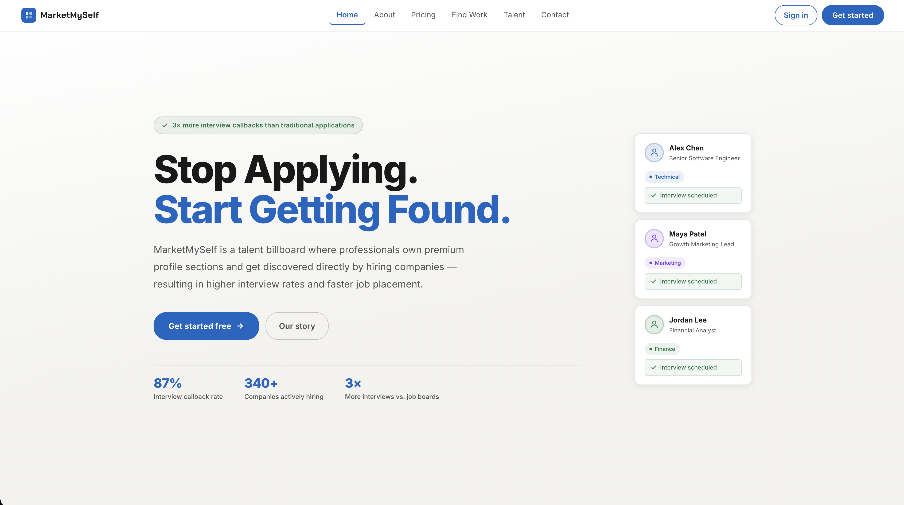
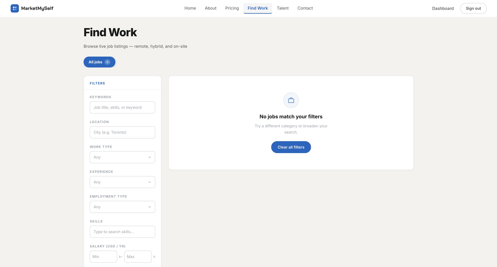
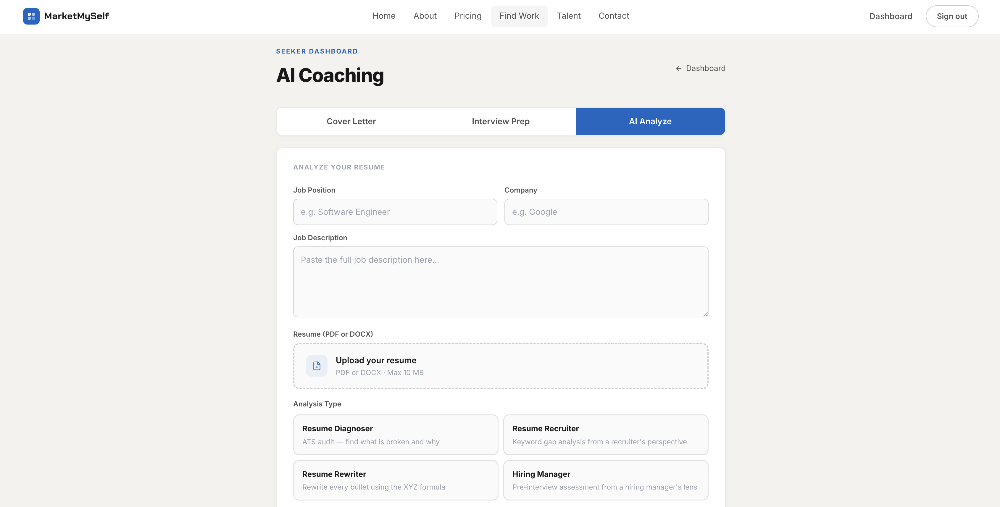
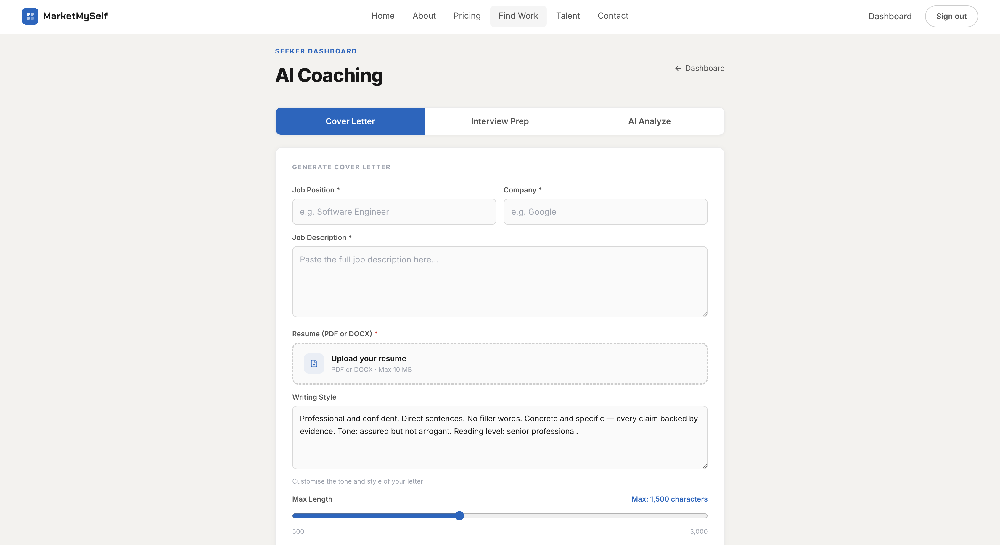
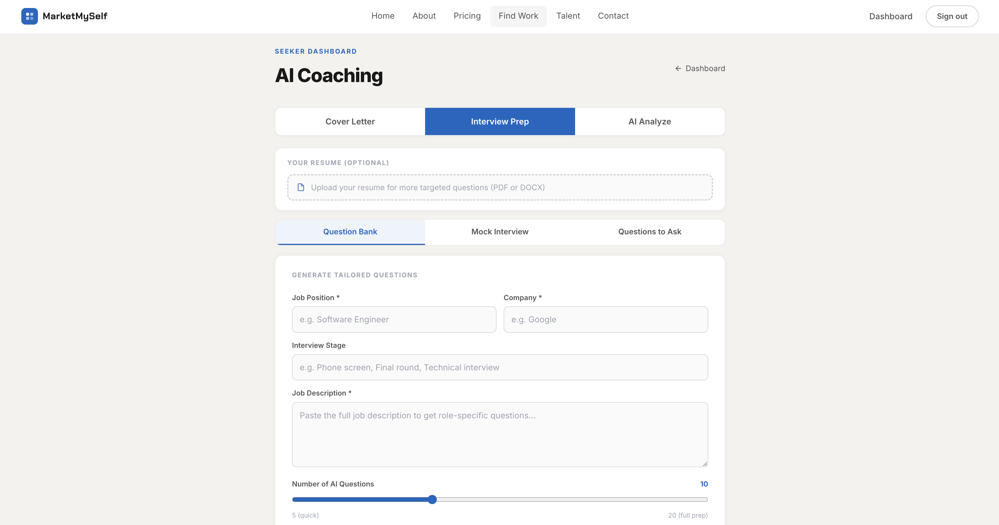

# MarketMySelf

> **Stop Applying. Start Getting Found.**

On a job board, you're one résumé in a pile of hundreds. MarketMySelf turns that around. You claim a spot on a shared talent billboard and present yourself like a brand, and companies come to you.

**For job seekers**
- **Own your section.** Claim one of 9,000 spots on the billboard (Technical, Marketing, or Finance) and build a profile with your photo, bio, skills, and portfolio.
- **Get coached by AI.** Upload your résumé for an ATS and keyword review, generate a cover letter tailored to the job, and practice with role-specific interview questions. Every result is saved to your dashboard.
- **Find work in one place.** Search listings collected from 17 job boards, with duplicates removed and results ranked by relevance.

**For companies**
- Browse talent by category, post jobs, and message candidates directly. No pile of résumés to sort through.

<p align="left">
  
  
  
  
  
  
  
  
</p>

**Live demo → [marketmyself-frontend.vercel.app](https://marketmyself-frontend.vercel.app)**
Next.js frontend and the FastAPI backend (as Python serverless functions) both deployed on Vercel.

---

## Screenshots

### Landing — the talent-billboard pitch

Personal-branding-first positioning: candidates own a profile section instead of firing off applications.



### Find Work — faceted full-text job search

The filter rail (keywords, location, work type, experience, employment type, skills, salary range) maps directly onto the backend's PostgreSQL full-text search — `to_tsvector`/`ts_rank` for relevance ranking, with facet counts aggregated in SQL.



### AI Coaching — three Claude-powered tools

One dashboard, three tabs. Every run is persisted and retrievable from history.

**Résumé Analysis** — upload a PDF/DOCX plus the target job, then pick one of four analysis lenses: *Resume Diagnoser* (ATS audit), *Resume Recruiter* (keyword-gap analysis), *Resume Rewriter* (rewrites each bullet with the XYZ formula), and *Hiring Manager* (pre-interview assessment).



**Cover Letter** — generates a tailored letter from the job description and your résumé, with a customisable writing-style prompt and a 500–3,000 character length control. Exportable to PDF.



**Interview Prep** — three modes (*Question Bank*, *Mock Interview*, *Questions to Ask*). Optionally attach a résumé for sharper targeting, set the interview stage, and generate 5–20 role-specific questions.



---

## Highlights

- **Three-service monorepo** — a FastAPI (Python) backend, a Next.js 14 (TypeScript) frontend, and a standalone async job-ingestion pipeline, each independently runnable.
- **Custom JWT auth with role-based access control** — the backend issues and verifies its own HS256 tokens layered over Supabase Auth, with access/refresh rotation and dependency-injected role guards (`seeker` / `recruiter`).
- **AI career-coaching suite** — résumé analysis, cover-letter generation, and interview-prep questions/answers backed by **Anthropic Claude**, with **multi-model routing** (frontier vs. cost-optimized) and PDF/DOCX extraction + PDF export.
- **Full-text job search** — **PostgreSQL `tsvector`/`ts_rank`** relevance ranking with dynamically aggregated facets and pagination — no external search engine required.
- **Async job-ingestion pipeline** — 17 source adapters (9 API/feed + 8 Playwright browser-based) feed a two-stage *fetch → normalise → deduplicate → upsert* flow, with content-hash + fuzzy dedup, anti-detection (proxy pool, throttling, browser profiles), and a pytest suite.
- **Stripe integration** — one-time section purchases and recurring subscriptions with webhook handling.
- **Production concerns baked in** — per-endpoint rate limiting, CORS allow-listing, input sanitization (`bleach`), CSP headers, and Alembic-managed migrations.

---

## Architecture

```
MarketMySelf/
├── backend/          FastAPI · SQLAlchemy 2.0 · Supabase (PostgreSQL) · Stripe · Claude
│   ├── routers/      auth · sections · payments · subscriptions · jobs · applications
│   │                 search · profile · ai_coaching · scraped_jobs · images
│   ├── models/       SQLAlchemy ORM models (users, sections, payments, coaching, …)
│   ├── schemas/      Pydantic v2 request/response validation
│   ├── services/     Business logic (AI coaching, resume, cover letter, interview,
│   │                 Stripe, job search, image processing)
│   ├── middleware/   Rate limiting (slowapi) · role-based auth guard (JWT)
│   └── migrations/   Alembic
│
├── frontend/         Next.js 14.2 · TypeScript · React 18
│   ├── app/          Talent billboard, dashboard, recruiter portal, coaching, pricing
│   ├── components/   Grid, résumé upload, job cards, search filters, notifications
│   └── lib/          Typed API client, auth context, Supabase & Stripe clients
│
├── job_scraper/      Standalone async ingestion service (Python)
│   ├── cli.py        fetch-raw · normalize · es  commands
│   ├── scraper/
│   │   ├── adapters/     17 sources — 9 API/feed (RemoteOK, Remotive, Adzuna,
│   │   │                 Jobicy, Himalayas, HN Hiring, JSearch, SerpAPI, Dice)
│   │   │                 + 8 Playwright (LinkedIn, Indeed, Glassdoor, Wellfound,
│   │   │                 ZipRecruiter, CareerBuilder, Google Jobs, Dice)
│   │   ├── anti_detect/  Proxy pool · request throttling · browser profiles
│   │   ├── normalizer.py Per-source payload → canonical schema
│   │   ├── deduplicator.py  Content-hash + fuzzy matching (rapidfuzz)
│   │   ├── es_*.py       Optional Elasticsearch indexing & search
│   │   └── scheduler.py  Recurring ingestion runs
│   └── tests/        pytest + pytest-asyncio
│
└── claude/           Architecture & design documentation
```

The three services are decoupled: the scraper never calls the API. It writes into
Postgres, and the backend reads from it — the database is the only handoff point.

```
job_scraper ──fetch──▶ raw_jobs ──normalize/dedupe──▶ scraped_jobs
                                                           │
                                    backend  GET /scraped-jobs/search
                                    (PostgreSQL full-text search)
                                                           │
                                            frontend  "Find Work" page
```

---

## Tech Stack

### Backend — `backend/`
| Concern | Technology |
|---|---|
| API framework | **FastAPI** (async), Uvicorn |
| ORM & migrations | **SQLAlchemy 2.0**, Alembic |
| Database | **PostgreSQL** via **Supabase** (`psycopg2`) |
| Validation | **Pydantic v2** |
| Auth | Custom **JWT** (`python-jose`), `passlib`/bcrypt, Supabase Auth |
| Payments | **Stripe** (payment intents, subscriptions, webhooks) |
| AI / LLM | **Anthropic Claude**, **OpenRouter** (multi-model routing) |
| Document processing | `pdfplumber`, `python-docx`, `reportlab` (PDF gen), Pillow |
| Search | **PostgreSQL full-text search** (`tsvector` / `ts_rank`) |
| Hardening | `slowapi` rate limiting, `bleach` sanitization, CORS allow-list |

### Frontend — `frontend/`
| Concern | Technology |
|---|---|
| Framework | **Next.js 14.2** (App Router), **React 18** |
| Language | **TypeScript 5.4** |
| State/Auth | React Context (`useAuth`), memory access token + refresh rotation |
| Payments | `@stripe/stripe-js` |
| Media | `react-dropzone`, `react-image-crop` |
| Styling | Design-token system (inline styles), custom CSS animations |

### Job Scraper — `job_scraper/`
| Concern | Technology |
|---|---|
| Runtime | **async Python** (`asyncio`, `httpx`, `asyncpg`) |
| Browser automation | **Playwright** + `playwright-stealth`, BeautifulSoup / lxml |
| Dedup & cleaning | `rapidfuzz` (fuzzy matching), `ftfy` (text repair) |
| Optional search index | **Elasticsearch 8.x** |
| Config | `pydantic-settings` |
| Testing | `pytest`, `pytest-asyncio`, `respx` (HTTP mocking) |

---

## Backend — Deep Dive

Python 3.14 · FastAPI · SQLAlchemy 2.0 · PostgreSQL · demonstrating API design, relational modeling, auth, and production hardening.

### Routing & API design
- **Modular router architecture** — 11 `APIRouter` modules (`auth`, `sections`, `payments`, `subscriptions`, `jobs`, `scraped_jobs`, `applications`, `search`, `profile`, `ai_coaching`, `images`), each mounted with its own prefix and OpenAPI tag and composed in `main.py`.
- **RESTful semantics** — correct verbs (`GET`/`POST`/`PATCH`/`DELETE`), explicit status codes (`201 Created`, `429`, `403`), and resource-oriented paths with typed path/query parameters (e.g. `PATCH /coaching/interview-prep/sessions/{session_id}`).
- **Layered separation of concerns** — thin routers delegate to a `services/` layer for business logic, validate through **Pydantic v2** `schemas/`, and persist via SQLAlchemy `models/`. Auto-generated, environment-gated **Swagger/OpenAPI** docs (disabled in production).
- **Async endpoints** — FastAPI `async` handlers over a pooled SQLAlchemy session layer.

### Authentication & authorization
- **Layered identity** — credentials are verified against **Supabase Auth**, but the backend mints and validates its **own HS256 JWTs**, decoupling the API's session model from the provider.
- **Access/refresh token rotation** — short-lived access tokens (15 min) paired with long-lived refresh tokens (30 days); `POST /auth/refresh` re-issues the pair and re-reads the user's current role on every refresh.
- **Role-based access control (RBAC)** — the signed token carries a `role` claim (`seeker` / `recruiter`); a reusable `require_role(*roles)` dependency guards recruiter-only routes and returns `403` on mismatch.
- **Secure credential handling** — bcrypt via `passlib`; registration uses the anon key to preserve the email-verification flow (a deliberate choice — the service key would auto-confirm and skip verification); password changes re-authenticate the current password before applying via the admin API.

### Middleware & hardening
- **Per-endpoint rate limiting** — `slowapi` with granular limits (`5/min` on register/change-password, `10/min` on login, `120/min` on search) and a custom `429` JSON handler.
- **Strict CORS** — explicit origin allow-list, method whitelist, and a curated header set (including `stripe-signature` for webhook verification).
- **Input sanitization** — user-supplied HTML scrubbed with `bleach`; CSP headers enforced at the edge.
- **Secrets discipline** — all keys via environment; access tokens never persisted server-side.

### Data & persistence (SQL / PostgreSQL)
- **SQLAlchemy 2.0** modern `DeclarativeBase` ORM over Supabase-managed **PostgreSQL**.
- **Tuned connection pool** — `pool_pre_ping`, `pool_size=10`, `max_overflow=20`, with a request-scoped `get_db` session dependency ensuring deterministic cleanup.
- **Relational schema** — 14 models (`User`, `PixelSection`, `Payment`, `Subscription`, `JobPost`, `Application`, `ScrapedJob`, `CoachingSession`, `ResumeAnalysis`, `CoverLetter`, `InterviewPrep`, `Notification`, `PromptTemplate`) using **UUID primary keys**, schema-qualified tables, timezone-aware timestamps, and DB-side `server_default` values.
- **Native full-text search** — job search is built directly on **PostgreSQL FTS**: `to_tsvector('english', …)` over title + description with `ts_rank` relevance ordering, hand-written parameterized SQL, faceted counts via `GROUP BY`, and pagination.
- **Versioned migrations** — schema managed with **Alembic**.

### AI integration
- **Provider abstraction** — a service layer wraps both the native **Anthropic Claude SDK** and **OpenRouter**, with **multi-model routing** that selects a frontier model (`claude-sonnet-4`) for high-value tasks and a cost-efficient model (`gpt-4o-mini`) for cheaper ones — a real cost/quality tradeoff.
- **Document pipeline** — résumés are ingested from PDF/DOCX (`pdfplumber`, `python-docx`), analyzed by the LLM, and generated artifacts (cover letters) are rendered back to PDF with `reportlab`.
- **Persisted sessions** — every analysis, question set, and generated answer is stored and exposed through history endpoints.

---

## Frontend — Deep Dive

Next.js 14 (App Router) · TypeScript · React 18 · demonstrating typed data access, complex authenticated UX, and full-stack integration.

### Typed, full-stack API layer
- A **650-line strongly-typed API client** (`lib/api.ts`) is the single boundary to the backend: a generic `request<T>()` wrapper centralizes base URL, JSON handling, and error propagation; helpers compose `authHeaders(token)` and `buildQuery()` for type-safe query strings; `FormData` used for multipart image/résumé uploads.
- **Auth context** (`useAuth`) keeps the access token in memory only, persists the refresh token, and auto-restores the session on mount — mirroring the backend's rotation model on the client.

### Job discovery
- **Faceted full-text search** — `JobSearchFilters` drives multi-dimensional queries (query text, work type, experience level, employment type, skills, salary range, location, company) against `GET /scraped-jobs/search`, which resolves them through PostgreSQL full-text search with relevance ranking and live facet counts.
- **First-party postings too** — recruiters create/update/delete their own listings (`/jobs`), rendered alongside aggregated jobs via reusable `JobListingCard` / `ScrapedJobCard` components.

### AI-powered user dashboard
The authenticated dashboard (`/dashboard/coaching`) surfaces the AI coaching suite end-to-end — see [Screenshots](#screenshots):
- **Résumé analysis** — drag-and-drop PDF/DOCX upload (`react-dropzone`) → backend text extraction → LLM analysis, across four selectable lenses (ATS diagnoser, recruiter keyword-gap, XYZ-formula rewriter, hiring-manager assessment), with saved history.
- **Cover-letter generator** — job description + résumé → tailored letter, with a user-editable writing-style prompt and a 500–3,000 character length control; exportable to PDF.
- **Interview prep** — three modes (question bank, mock interview, questions to ask); takes an optional résumé and interview stage, generates 5–20 role-specific questions, captures user answers, and produces AI model answers across persisted sessions.
- Each feature is a typed request/response round-trip through the API client, with loading, success, and error states styled from a shared design-token system.

### Role-aware, component-driven UI
- **Two experiences from one app** — a **seeker** dashboard (profile builder, applications, coaching) and a **recruiter portal** (`/recruiter` — talent search, job posting, candidate hiring), gated by the role claim.
- **Reusable component library** — `TalentCard`, `ApplicationList`, `JobPostForm`, `SearchFilters`, `ResumeUpload`, `NotificationBadge`, `SubscriptionBadge`, and an interactive image cropper (`react-image-crop`).
- **Interactive talent billboard** — the pixel-grid canvas with modal editors, plus **Stripe Checkout** (`@stripe/stripe-js`) for one-time section purchases and recurring subscriptions.
- **Notifications** — recruiters message candidates; unread state is surfaced through a reusable count badge and read/unread endpoints.

---

## Job Ingestion Pipeline — Deep Dive

`job_scraper/` is a standalone async service — no FastAPI, no HTTP surface. It exists to turn messy third-party job listings into clean, deduplicated rows the app can search.

### Two-stage design
Fetching and parsing are **deliberately separated** so a parser bug never costs a re-fetch:

1. **`fetch-raw`** — hits every selected source concurrently and stores the untouched payload in `raw_jobs`. Raw responses are preserved verbatim.
2. **`normalize`** — reads unprocessed `raw_jobs`, runs each row through its per-source adapter into a canonical schema, deduplicates, and upserts into `scraped_jobs`. Rows are marked processed, so runs are idempotent; `--reprocess` re-runs adapters over stored payloads without re-hitting the network.

### Source adapters
17 sources behind one interface, split by acquisition strategy:
- **API/feed adapters** (9) — RemoteOK, Remotive, Adzuna, Jobicy, Himalayas, HN Hiring, JSearch, SerpAPI, Dice. Fast, key-free where possible.
- **Browser adapters** (8) — LinkedIn, Indeed, Glassdoor, Wellfound, ZipRecruiter, CareerBuilder, Google Jobs, Dice — driven by **Playwright** with stealth patches for boards that block plain HTTP clients.

### Data quality
- **Deduplication** — content-hash for exact matches plus `rapidfuzz` fuzzy matching to collapse the same role cross-posted to several boards under different titles.
- **Normalisation** — salary parsing (ranges, currencies, periods), experience-level and work-type inference, `ftfy` mojibake repair, and HTML stripping into the plain text the backend's `tsvector` indexes.

### Operational concerns
- **Anti-detection** — rotating proxy pool, per-host request throttling, and randomised browser profiles.
- **Resilience** — Elasticsearch indexing is best-effort and never blocks the pipeline; **PostgreSQL remains the source of truth**, which is why the app's search runs on Postgres FTS and needs no external search cluster.
- **Tested** — `pytest`/`pytest-asyncio` cover the normalizer, deduplicator, and ES layers, with `respx` mocking HTTP so tests never touch live boards.

---

## Getting Started

### Backend
```bash
cd backend
python3 -m venv venv && source venv/bin/activate
pip3 install -r requirements.txt
alembic -c migrations/alembic.ini upgrade head
uvicorn main:app --reload --port 8000        # docs at http://localhost:8000/docs
```

### Frontend
```bash
cd frontend
npm install
npm run dev                                   # http://localhost:3000
```

### Job Scraper
```bash
cd job_scraper
python3 -m venv .venv && source .venv/bin/activate
pip3 install -r requirements.txt
playwright install                            # only needed for the browser adapters

# 1. fetch listings into raw_jobs (these four sources need no API keys)
python3 cli.py fetch-raw --query "software engineer" \
  --sources remoteok remotive himalayas jobicy --output /tmp/raw.json

# 2. normalise + deduplicate into scraped_jobs (what the app searches)
python3 cli.py normalize --limit 500 --output /tmp/norm.json
```
Pass `--output` — omitted, the command pretty-prints every listing to stdout. Run `python3 cli.py --help` for all commands (`fetch-raw`, `normalize`, `es`).

Each service reads configuration from its own `.env` (database URL, Supabase keys, Stripe keys, JWT secret, LLM and job-board API keys). The scraper only needs `DATABASE_URL` — it writes to the same Postgres the backend reads.

---

## Engineering Notes

- **Separation of concerns** — routers stay thin; business logic lives in `services/`, validation in `schemas/`, persistence in `models/`. The scraper is fully decoupled from the web app and communicates only through the shared database.
- **Search without extra infrastructure** — job search runs on native PostgreSQL full-text search (`tsvector`/`ts_rank`) with SQL-aggregated facets, avoiding an external search dependency while keeping results relevance-ranked.
- **Idempotent ingestion** — raw payloads are stored before parsing, so adapters can be fixed and re-run over historical data without re-scraping; dedup keys make repeated runs safe.
- **Security-first defaults** — role-scoped JWT guards, per-route rate limits, HTML sanitization on user input, strict CORS/CSP, and access tokens kept out of persistent storage.

---

## License

Released under the [MIT License](LICENSE).

---

<sub>Built as a full-stack portfolio project demonstrating end-to-end product engineering — API design, relational data modeling, full-text search, third-party integrations (Stripe, Supabase, LLM providers), and modern React.</sub>
